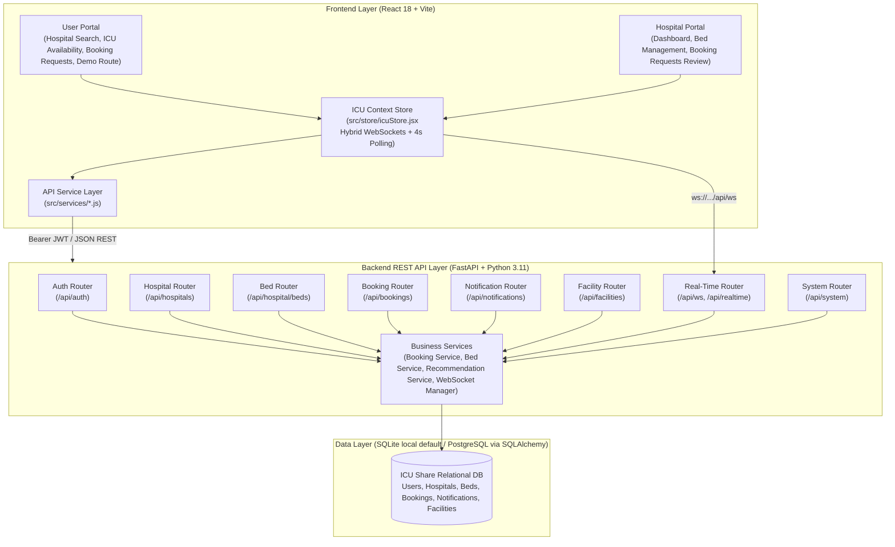

# ICU Share – A Multi-Hospital ICU Bed Resource Coordination and Booking Platform
## System Architecture, Technical Implementation & Audit Report

---

### Executive Summary

**ICU Share** is a full-stack web-based ICU resource coordination platform that allows users to search hospitals with ICU availability and submit booking requests, while hospitals can manage ICU beds and respond to requests through a dedicated hospital portal.

The platform bridges the critical coordination gap between patients/attendants requiring urgent intensive care and hospital administrators managing intensive care unit (ICU) beds. The system provides transparency into hospital ICU capacity, eliminates double-booking through direct bed reservation upon hospital acceptance, and delivers rule-based alternative hospital recommendations when capacity is reached.

---

## 1. System Architecture



---

## 2. Consolidation & Audit Summary

In accordance with the project consolidation guidelines:

### 1. What Was Removed
- **EMS & Ambulance Dispatching Overhead**: Removed terms and mock logic related to EMS dispatchers, ambulance telemetry, priority green signal corridors, and transit vehicle management.
- **Insecure Header-Based Authorization**: Purged `x-hospital-id` and `x-user-id` header bypasses from the backend. Hospital authorization is strictly resolved from verified JWT access tokens.
- **Detailed Clinical Vitals & Notes**: Removed requirements for clinical patient vitals (e.g., blood pressure, oxygen saturation, heart rate, diagnosis notes) from the required schema, keeping only necessary patient information: Name, Mobile, Severity, Beds Required, Facilities, and Current Location.
- **Unsubstantiated AI Claims**: Clarified and documented the hospital recommendation model as an explicit rule-based multi-criteria suitability scoring engine ($S = w_1A + w_2F + w_3D + w_4T$), avoiding claims of machine learning, neural networks, or clinical diagnosis.
- **Static Mock Data Dependencies**: Removed hardcoded bed counters and mock booking arrays. All bed counts and statuses are queried dynamically from database records.

### 2. What Was Retained
- **Original User Portal**: Full hospital search by location, type, and facility; real-time ICU bed availability display; booking request submission form; user booking status tracking; user notifications.
- **Original Hospital Portal**: Hospital dashboard with dynamic bed counts (Total, Available, Occupied, Reserved, Maintenance); interactive ICU bed management table with status toggles; incoming booking request review with Accept/Reject actions.
- **Demo Route Estimate**: Retained a clean user-to-hospital route estimate visualization clearly labeled as "Demo Route Estimate".
- **Rule-Based Hospital Recommendations**: Retained alternative hospital suggestions when a booking request is rejected.
- **Demo Data & Credentials**: Maintained realistic demo dataset with 6 hospitals and 26 seeded ICU beds (28 beds currently present in active SQLite database file) across Chennai and Coimbatore.

### 3. What Was Improved
- **Bed Count Consistency**: Dashboard bed counts are calculated strictly as `total = len(beds)` directly from `icu_beds` records in the database.
- **Double-Booking Prevention**: When a hospital accepts a booking, the designated bed status transitions atomically from `AVAILABLE` to `RESERVED`, preventing concurrent assignment.
- **Strict Role-Based Access Control**: Backend endpoints enforce token authentication; hospitals cannot access or modify beds or bookings belonging to another institution.
- **Frontend & Backend Synchronization**: Hybrid synchronization architecture combining real-time WebSocket event broadcasting (`/api/ws`) for immediate reactivity with resilient 4-second backup HTTP polling and cross-tab `localStorage` event synchronization.

---

## 3. Database Schema

The database schema is implemented in SQLAlchemy 2.0 with default local SQLite runtime (`backend/icushare.db`, configured via `DATABASE_URL=sqlite:///./icushare.db` in `backend/.env`) and PostgreSQL support when `DATABASE_URL` is set to a PostgreSQL connection:

| Table | Columns | Notes |
| :--- | :--- | :--- |
| **`users`** | `id`, `name`, `mobile`, `email`, `password_hash`, `role`, `designation`, `created_at` | Primary user identity (`role="USER"`) |
| **`hospitals`** | `id`, `name`, `city`, `area`, `address`, `type`, `latitude`, `longitude`, `phone`, `emergency_contact`, `doctor_in_charge`, `registration_id`, `email`, `password_hash`, `total_beds`, `created_at` | Institution identity (`role="HOSPITAL"`) |
| **`hospital_facilities`** | `id`, `hospital_id`, `facility_name` | One-to-many relationship with hospitals |
| **`icu_beds`** | `id`, `hospital_id`, `bed_number`, `bed_type`, `ward`, `status`, `expected_release_at`, `note` | Status: `AVAILABLE`, `OCCUPIED`, `RESERVED`, `MAINTENANCE` |
| **`bookings`** | `id`, `user_id`, `hospital_id`, `patient_name`, `patient_mobile`, `severity`, `beds_required`, `current_location`, `status`, `assigned_bed_id`, `rejection_reason`, `created_at`, `updated_at` | Status: `PENDING`, `ACCEPTED`, `CONFIRMED`, `REJECTED`, `CANCELLED` |
| **`booking_facilities`** | `id`, `booking_id`, `facility_name` | One-to-many relationship with bookings |
| **`notifications`** | `id`, `user_id`, `hospital_id`, `booking_id`, `title`, `message`, `type`, `is_read`, `created_at` | Notifications for user & hospital portals |

---

## 4. Core Business Workflows

### Scenario 1: Booking Creation, Hospital Acceptance & Bed Reservation
1. User logs in with JWT (`user@icushare.org`).
2. User searches hospitals by location and facility requirements.
3. User selects a hospital with available beds and submits a booking request.
4. Booking is saved with initial status `PENDING` and ID `ICU-REQ-XXXX`.
5. Receiving hospital logs in (`/hospital/login`), navigates to `/hospital/bookings`, and views the pending request.
6. Hospital selects an available ICU bed and clicks **Accept**.
7. In a database transaction:
   - Bed status transitions: `AVAILABLE` $\rightarrow$ `RESERVED`.
   - Booking status transitions: `PENDING` $\rightarrow$ `CONFIRMED`.
   - Notification is created for the user.
8. User portal refreshes: displays booking as `CONFIRMED` with assigned bed and provides the Demo Route Estimate.

### Scenario 2: Booking Rejection, Recommendations & Manual Rebooking
1. User submits a booking request to a hospital.
2. Hospital reviews the request and clicks **Reject** with a reason (e.g., *"Emergency surge capacity reached"*).
3. Booking status becomes `REJECTED`.
4. User receives rejection notification.
5. User portal fetches rule-based recommendations (`GET /api/hospitals/recommendations`), which excludes the rejecting hospital and ranks alternative candidates by available beds, facility match, and distance.
6. The user explicitly selects an alternative hospital and submits a new booking request.
7. The second hospital receives the new request in its incoming queue.

---

## 5. Verification & Test Report

- **Backend Pytest Suite**: 16 tests executed; 16 passed in 20.47s (0 warnings, 0 errors).
- **Frontend Production Build**: Vite compiled 1,618 modules into `dist/` in 9.55s (0 errors).
- **Scenario Script Verification**: Executed `scratch/run_scenarios.py` against live backend; all 12 validation steps in Scenario 1 and all 8 validation steps in Scenario 2 passed with 100% assertions satisfied.

---

## 6. How to Run the Platform

### Unified Single-Server Run (Recommended)
Merges Frontend SPA, Backend REST APIs, SQLite Database, and Real-Time WebSockets into ONE unified web server:

```bash
# In the project root directory:
python run.py
```
Or via npm:
```bash
npm start
```
- **Unified Web Application**: `http://127.0.0.1:8000/` (User & Hospital portals fully merged)
- **Backend API Docs**: `http://127.0.0.1:8000/docs`
- **Real-Time WebSocket Stream**: `ws://127.0.0.1:8000/api/ws`
- **Database**: Relational SQLite (`backend/icushare.db`)

### Optional Development Mode
```bash
# Terminal 1: Backend API + WebSockets
cd backend
python -m uvicorn app.main:app --host 127.0.0.1 --port 8000

# Terminal 2: Frontend Vite Dev Server
npm run dev -- --host 127.0.0.1 --port 5173
```

